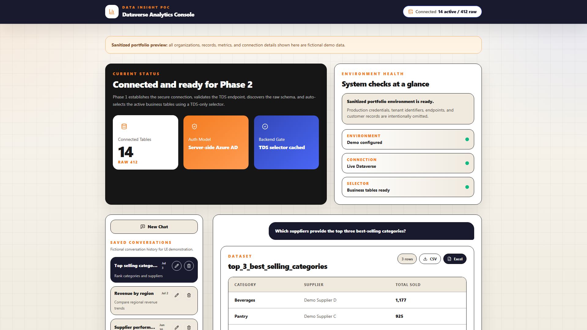
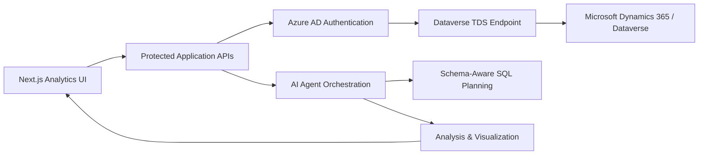

# Microsoft Dynamics 365 & Dataverse Supply Chain AI Analytics

> [!IMPORTANT]
> **Client-confidential portfolio showcase.** This repository intentionally contains only a sanitized subset of the frontend. It is shared exclusively to demonstrate my engineering skill set; it is not the complete client application.

An enterprise analytics experience designed around **Microsoft Dynamics 365**, **Microsoft Dataverse**, secure **Azure AD** authentication, the **Dataverse TDS endpoint**, and AI-assisted supply-chain intelligence.



_The screenshot above was generated from this public showcase using fictional demo records and metrics. It contains no client data._

## What the full solution does

The private production solution turns Dynamics 365 and Dataverse business data into a conversational analytics workflow. Authorized users can connect an environment, discover relevant business tables, ask natural-language questions, and receive structured answers as KPIs, tables, charts, or analytical summaries.

At a high level, the system covers:

- Microsoft Dynamics 365 and Dataverse integration through the TDS endpoint
- Server-side Azure AD authentication and protected connection handling
- Dynamic schema discovery, business-table selection, and relationship analysis
- Natural-language supply-chain questions and multi-step analytical workflows
- AI-agent orchestration for routing, SQL planning, analysis, and visualization
- Interactive datasets with CSV and Excel export experiences
- Conversation history and reusable analytics sessions
- Responsive dashboard components built for operational and executive users

## Architecture overview



Only the sanitized **Next.js Analytics UI** portion is represented in this repository. The protected APIs, authentication implementation, data-access layer, agent prompts, orchestration logic, and production infrastructure remain private.

## Frontend capabilities demonstrated

- Responsive operational analytics dashboard
- Dataverse connection-health and schema-status presentation
- Supply-chain conversational analytics workspace
- Saved-conversation navigation patterns
- Structured dataset and export controls
- Accessible visual hierarchy and reusable card/table components
- Tailwind CSS design system with custom colors, borders, shadows, and layouts
- Strict TypeScript configuration and static production rendering

## Technology represented

| Area | Technology |
| --- | --- |
| Frontend | Next.js 14, React 18, TypeScript |
| Styling | Tailwind CSS, responsive component design |
| Icons | Lucide React |
| Enterprise data | Microsoft Dynamics 365, Microsoft Dataverse |
| Connectivity | Dataverse TDS endpoint, SQL-compatible analytics |
| Identity | Microsoft Entra ID / Azure AD |
| Intelligence | OpenAI agent workflows and schema-aware analytics |
| Quality | ESLint, TypeScript strict mode, production build validation |

## Repository scope

Included:

- Selected sanitized frontend components
- Fictional demo state and sample supply-chain metrics
- Styling and build configuration required to preview the UI
- Portfolio screenshot and technical documentation

Intentionally omitted:

- Backend routes and server-side services
- Microsoft tenant IDs, application IDs, secrets, and Dataverse URLs
- Database credentials, tokens, environment files, and production configuration
- Proprietary prompts, agent implementations, and orchestration logic
- Client datasets, schemas, business rules, logs, tests, and deployment assets
- The remainder of the confidential application source

## Local preview

```bash
npm install
npm run dev
```

Open `http://localhost:3000` in a browser.

Validation commands:

```bash
npm run lint
npm run typecheck
npm run build
```

## Confidentiality and usage

This work originated from a confidential client project. The repository is a curated portfolio artifact, not an open-source release. All organizations, conversations, suppliers, records, counts, and metrics visible in the demo are fictional.

No permission is granted to reuse, redistribute, reverse engineer, or represent this material as a complete production implementation. See [NOTICE.md](NOTICE.md) for the repository notice.

## Author

**Humair Yousaf**  
GitHub: [@humairyousaf6](https://github.com/humairyousaf6)
